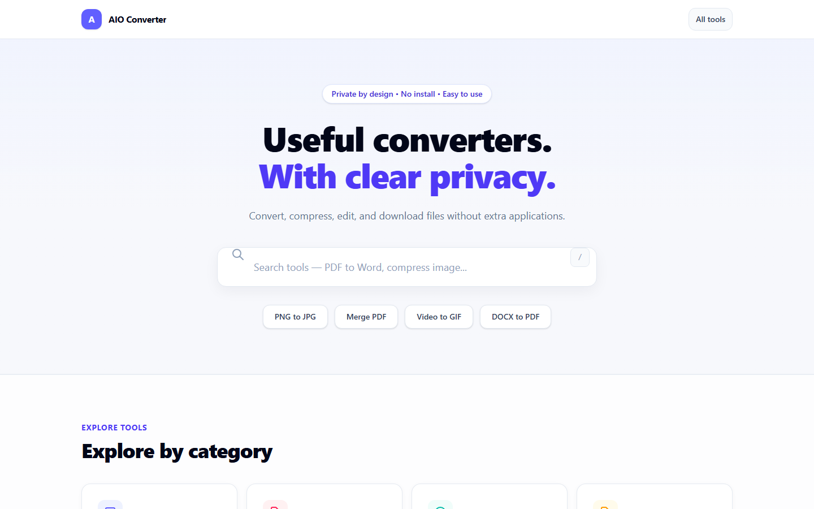
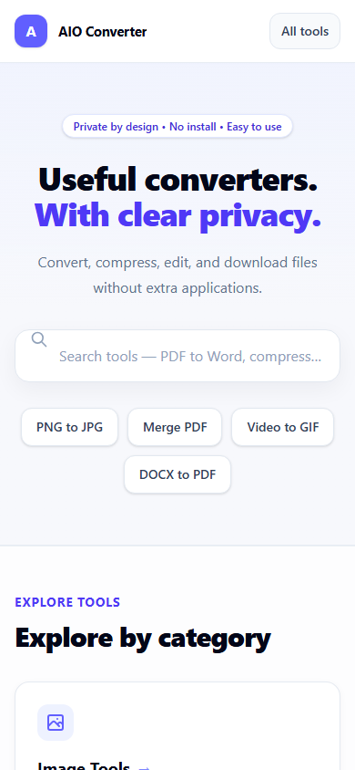
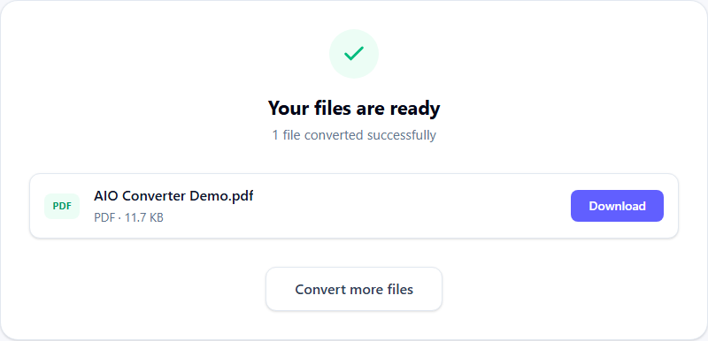
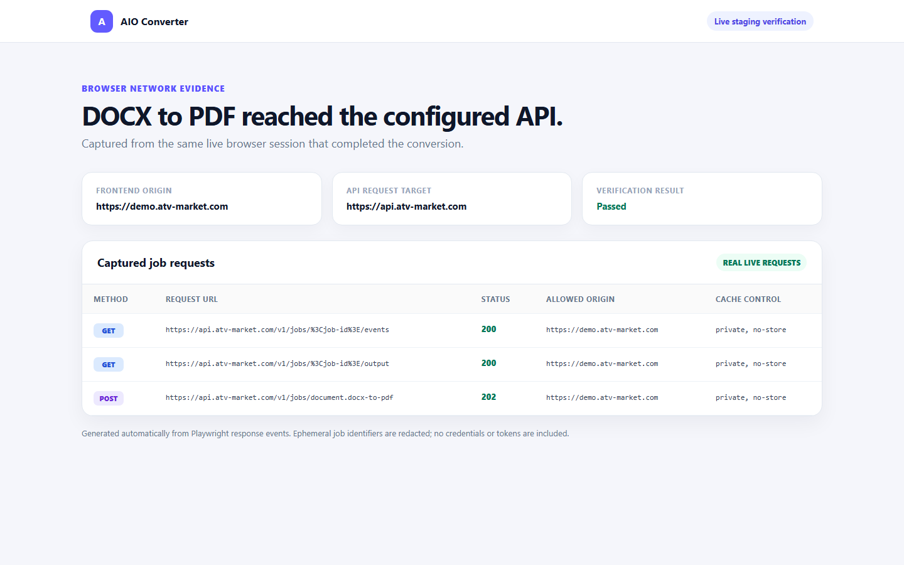

<p align="center">
  
</p>

<h1 align="center">AIO Converter</h1>

<p align="center">
  A growing browser-first file conversion toolbox with transparent privacy boundaries.
</p>

<p align="center">
  <a href="#tools">Tools</a> &middot;
  <a href="#privacy-model">Privacy</a> &middot;
  <a href="#architecture">Architecture</a> &middot;
  <a href="#demo-and-staging">Demo</a> &middot;
  <a href="#local-development">Local development</a> &middot;
  <a href="#testing">Testing</a>
</p>

> **Phase 2 status: engineering-ready for preview/staging, not production-ready.** The expanded image catalog and Converter Workspace are implemented. Production/tagged release remains blocked by unresolved FFmpeg provenance and pending libheif-js LGPL redistribution review.

## What it is

AIO Converter is a compact SaaS-style conversion app for everyday files. It keeps tools that can run safely in the browser on the device, and uses a deliberately short-lived server workflow only where a native application is necessary. The result is a clear product boundary: users can see whether a file stays local or is processed ephemerally before they start.

## Tools

| Tool           | Route                   | Processing         | Capability                                                                                        |
| -------------- | ----------------------- | ------------------ | ------------------------------------------------------------------------------------------------- |
| PNG to JPG     | `/image/png-to-jpg`     | `LOCAL_ONLY`       | Batch PNG conversion with quality/background controls and ZIP output.                             |
| JPG to PNG     | `/image/jpg-to-png`     | `LOCAL_ONLY`       | Browser-local JPG conversion to PNG.                                                              |
| JPG to WebP    | `/image/jpg-to-webp`    | `LOCAL_ONLY`       | Browser-local JPG conversion to WebP with quality control.                                        |
| PNG to WebP    | `/image/png-to-webp`    | `LOCAL_ONLY`       | Browser-local PNG conversion to WebP with transparency preserved.                                 |
| JPG to ICO     | `/image/jpg-to-ico`     | `LOCAL_ONLY`       | Multi-resolution ICO with 16, 32, 48, 64, 128, and 256 px entries.                                |
| PNG to ICO     | `/image/png-to-ico`     | `LOCAL_ONLY`       | Multi-resolution ICO with contain/padding for non-square input.                                   |
| HEIC to JPG    | `/image/heic-to-jpg`    | `LOCAL_ONLY`       | Browser-local HEIC decoding and JPG output; first top-level HEIF image only.                      |
| HEIC to PNG    | `/image/heic-to-png`    | `LOCAL_ONLY`       | Browser-local HEIC decoding and PNG output; first top-level HEIF image only.                      |
| Compress Image | `/image/compress-image` | `LOCAL_ONLY`       | Compresses JPEG/JPG, PNG, and WebP while preserving dimensions and format; batch/ZIP supported.   |
| Resize Image   | `/image/resize-image`   | `LOCAL_ONLY`       | Resizes JPEG/JPG, PNG, and WebP with locked proportional scaling by default; batch/ZIP supported. |
| Merge PDF      | `/pdf/merge-pdf`        | `LOCAL_ONLY`       | Combines PDFs in the user-controlled queue order.                                                 |
| Video to GIF   | `/video/video-to-gif`   | `LOCAL_ONLY`       | Converts short MP4, WebM, or MOV clips with duration, FPS, and width controls.                    |
| DOCX to PDF    | `/document/docx-to-pdf` | `SERVER_EPHEMERAL` | Validated DOCX conversion through isolated LibreOffice with one-time PDF download.                |

All routes share the same typed tool registry, metadata, validation, privacy labels, accessibility contracts, and responsive Converter Workspace behavior.

### Image utilities

- **Compress Image** accepts JPEG/JPG, PNG, and WebP. It preserves each image's dimensions and input format, supports quality-controlled recompression for JPEG/WebP, and uses browser-native re-encoding for PNG. Compression is not guaranteed to reduce every input; when a PNG re-encode is not smaller, the original file is retained. Batch processing produces a ZIP download.
- **Resize Image** accepts JPEG/JPG, PNG, and WebP, preserves the input format, and scales proportionally with the aspect ratio locked by default. PNG transparency is preserved, upscaling is allowed, and batch processing produces a ZIP download. When both dimensions are supplied while the lock is enabled, the width drives the derived height.

## Privacy model

### Browser-local tools

All image converters (including Compress Image and Resize Image), Merge PDF, and Video to GIF are `LOCAL_ONLY`. Files are processed in the browser through browser processors and workers where supported; image inputs are never submitted to `/v1/jobs`, and there is no silent server fallback. HEIC uses a browser-side libheif WASM decoder asset; downloading that application asset does not upload the user's image.

### Ephemeral server tool

DOCX to PDF is `SERVER_EPHEMERAL` because LibreOffice cannot run in the browser. The Go API streams the upload to a temporary job area, forwards work to an isolated LibreOffice runner over a Unix socket, and removes inputs and outputs through the job lifecycle. Job metadata stays in memory, output is available for one download, and API file responses use `Cache-Control: private, no-store`.

This is a practical privacy model, not a blanket compliance guarantee. Review the [security and privacy caveats](#security-and-privacy-caveats) before using the service with sensitive material.

## Architecture

```text
Astro static pages + React interactive workspace
                 |
                 v
        Typed tool registry and contracts
          |                       |
          | LOCAL_ONLY            | SERVER_EPHEMERAL
          v                       v
Browser processors/workers      Go job API
  -> Blob or ZIP download          |
                                  v
          Unix socket (default) or authenticated private TCP
                    -> LibreOffice runner
                                  |
                                  v
                       one-time PDF download
```

| Layer              | Technology                                                            | Responsibility                                                                                                                                  |
| ------------------ | --------------------------------------------------------------------- | ----------------------------------------------------------------------------------------------------------------------------------------------- |
| Frontend           | Astro, React, Tailwind CSS                                            | Static routes, metadata, accessibility, and the Converter Workspace.                                                                            |
| Registry           | Typed TypeScript workspace packages                                   | Tool routes, limits, options, privacy mode, SEO metadata, and processor mapping.                                                                |
| Browser processing | Web Workers, Canvas, `pdf-lib`, `ffmpeg.wasm`, libheif WASM, `fflate` | Local image/PDF/video conversion, progress, cancellation, and download creation.                                                                |
| Server processing  | Go API                                                                | Streaming DOCX uploads, job lifecycle, events, one-time output, and cleanup.                                                                    |
| Office runner      | LibreOffice container                                                 | Network-isolated document conversion with temporary scratch storage.                                                                            |
| Deployment         | Docker Compose                                                        | Connects the API and office runner through a Unix socket by default; authenticated private TCP is supported for distributed container networks. |

Read [the architecture guide](docs/architecture.md) for processing flows and security invariants.

## Demo and staging

### Live preview

- Frontend: [https://demo.atv-market.com](https://demo.atv-market.com)
- Backend API: [https://api.atv-market.com](https://api.atv-market.com)

The public staging deployment was manually verified as a Phase 1 snapshot across the routes and viewport sizes below. This historical verification does not claim that the new Phase 2 image routes are deployed there:

| Check                                    | Result                         |
| ---------------------------------------- | ------------------------------ |
| Homepage `/`                             | Passed                         |
| PNG to JPG `/image/png-to-jpg`           | Passed                         |
| Merge PDF `/pdf/merge-pdf`               | Passed                         |
| Video to GIF `/video/video-to-gif`       | Passed                         |
| DOCX to PDF `/document/docx-to-pdf`      | Passed through the staging API |
| Mobile layout                            | Passed at 390 px               |
| Desktop layout                           | Passed at 1440 px              |
| DOCX request target observed in DevTools | `https://api.atv-market.com`   |

### Screenshots

<table>
  <thead>
    <tr>
      <th>Desktop (1440 x 900)</th>
      <th>Mobile (390 x 844)</th>
    </tr>
  </thead>
  <tbody>
    <tr>
      <td></td>
      <td></td>
    </tr>
  </tbody>
</table>

[Browse the full-page homepage and converter screenshots](docs/screenshots/).

#### DOCX to PDF live API verification

The following captures came from one live conversion of a synthetic DOCX. The browser reached the configured API, received the completed PDF, and downloaded the one-time output. Ephemeral job identifiers are redacted, and no credentials or tokens are shown.

<p align="center">
  
</p>

<p align="center">
  
</p>

The supported preview path uses Cloudflare Workers Static Assets or a similar static host for `apps/web/dist`, plus Docker Compose for the Go API and LibreOffice runner. A Cloudflare Tunnel exposes the loopback-only API without directly publishing its port.

Use fixed HTTPS staging origins for `PUBLIC_APP_URL`, `PUBLIC_API_URL`, and `API_ALLOWED_ORIGINS`. Document only intentionally public staging origins; keep private hostnames, server addresses, tunnel credentials, and processor tokens out of Git. The full reproducible setup, including CSP/CORS verification, health checks, smoke tests, cleanup checks, and a placeholder-only Tunnel configuration, is in [docs/deployment.md](docs/deployment.md).

Staging/demo deployment is appropriate for preview and portfolio use. It is not a production release claim while the FFmpeg provenance gate remains unresolved.

## Local development

### Prerequisites

- Node.js 22.14 or newer
- Corepack and pnpm 11
- Go 1.24 or newer for API checks
- Docker Compose for DOCX-to-PDF and full-stack E2E
- Playwright Chromium for browser E2E

### Frontend and browser-local tools

```bash
corepack enable
pnpm install --frozen-lockfile
pnpm dev
```

Open <http://localhost:4321>. All `LOCAL_ONLY` tools—including Compress Image, Resize Image, the rest of the image catalog, Merge PDF, and Video to GIF—work without the Go API. DOCX to PDF requires the API and LibreOffice stack. Copy `.env.example` to an ignored `.env` only when local defaults need overriding.

### Docker/API quickstart

Start the document-processing stack in a second terminal:

```bash
docker compose up --build -d
docker compose ps
curl --fail --show-error http://127.0.0.1:8080/healthz
```

The API is bound to `127.0.0.1:8080`; the LibreOffice runner has no published port and no network access. For a single command that starts the frontend and API together, use `pnpm dev:docker`.

See [docs/development.md](docs/development.md) for browser compatibility, staging-like builds, and E2E prerequisites.

## Testing

Install Playwright Chromium once per development machine:

```bash
pnpm exec playwright install chromium
```

Run the standard quality gates from the repository root:

```bash
pnpm format:check
pnpm lint
pnpm typecheck
pnpm test
pnpm build
pnpm test:e2e
```

`pnpm test:e2e` needs Docker for the DOCX-to-PDF flow. `pnpm compliance` is also part of release review; its known FFmpeg provenance blocker is documented below and does not make a production release acceptable.

Phase 2 real HEIC conversion has been verified in Chromium and WebKit. Firefox HEIC verification is currently environment-not-verified because the local browser runner fails before application execution; this is not an application-level unsupported-browser claim. See [docs/development.md](docs/development.md) for detailed compatibility notes.

## Security and privacy caveats

- Browser-local tools do not use the job API, but Video to GIF can consume substantial memory and may not be suitable for low-end devices or long clips.
- Browser image processing can be memory intensive for large images; source and requested dimensions are guarded by the existing 40-megapixel safety limit.
- Multi-image HEIF files currently convert only the first top-level image. HEIF orientation handling remains unverified.
- DOCX-to-PDF files are intentionally short-lived, but LibreOffice fidelity depends on the fonts and capabilities available in the runner image; a PDF may not precisely match Microsoft Word layout.
- The API is designed for temporary processing, not as a persistent file store. Do not assume it meets a regulated-data requirement without an environment-specific security review.
- Staging deployments should use HTTPS, exact-origin CORS, the existing CSP/security headers, and a loopback-only API behind an approved proxy or Tunnel. Do not weaken those controls to work around a deployment issue.
- Do not commit `.env` files, user documents, private or unapproved hostnames, server IPs, tunnel credentials, or processor tokens.

## Release status and compliance

| Area                               | Current status                                            |
| ---------------------------------- | --------------------------------------------------------- |
| Source license                     | **GPL-3.0-or-later**                                      |
| Public source repository           | OK                                                        |
| FFmpeg WASM provenance             | **Blocked pending evidence**                              |
| libheif-js                         | LGPL-3.0 dependency for browser HEIC decoding             |
| libheif-js redistribution handling | **Review required before production/tagged distribution** |
| Production or tagged release       | **Blocked**                                               |

The repository can be shared publicly under GPL-3.0-or-later. However, the prebuilt FFmpeg WASM artifact does not yet have verified corresponding-source/build provenance. The generated frontend also distributes compiled libheif browser code/WASM through `libheif-js@1.19.8`; appropriate LGPL notices, license text, corresponding-source, and relinking handling require review before production/tagged distribution. These are separate compatibility and redistribution obligations. See [the FFmpeg provenance gate](docs/compliance/ffmpeg.md) and [third-party notices](THIRD_PARTY_NOTICES.md).

## Roadmap

1. Complete release compliance: resolve FFmpeg provenance and review libheif-js LGPL redistribution handling.
2. Verify and deploy the expanded image catalog to staging.
3. Continue tool expansion after the current image catalog is stable.

## Documentation

- [Architecture and privacy model](docs/architecture.md)
- [Local development and browser compatibility](docs/development.md)
- [Staging/preview deployment guide](docs/deployment.md)
- [FFmpeg provenance and release gate](docs/compliance/ffmpeg.md)
- [Third-party notices](THIRD_PARTY_NOTICES.md)
