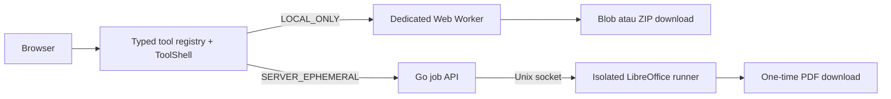

<p align="center">
  
</p>

<h1 align="center">AIO Converter</h1>

<p align="center">
  Platform konversi file modular dengan pemrosesan lokal di browser dan job server sementara untuk format yang membutuhkan aplikasi native.
</p>

<p align="center">
  <a href="#fitur-phase-1">Fitur</a> ·
  <a href="#quick-start">Quick start</a> ·
  <a href="#arsitektur">Arsitektur</a> ·
  <a href="#testing">Testing</a> ·
  <a href="#deployment">Deployment</a>
</p>

> **Status: Phase 1 / beta.** Fondasi aplikasi dan empat reference tool sudah berfungsi. UI/UX masih berupa baseline yang responsif dan keyboard-accessible karena desain final sedang disiapkan di Figma.

## Fitur Phase 1

| Tool         | Mode pemrosesan  | Batas utama                             | Hasil                  |
| ------------ | ---------------- | --------------------------------------- | ---------------------- |
| PNG to JPG   | Lokal di browser | 1–50 file, 50 MiB/file, 200 MiB total   | JPG satuan atau ZIP    |
| Merge PDF    | Lokal di browser | 2–20 file, 50 MiB/file, 250 MiB total   | Satu PDF sesuai urutan |
| Video to GIF | Lokal di browser | 1 file, 150 MiB, clip maksimal 30 detik | GIF                    |
| DOCX to PDF  | Server sementara | 1 file, 50 MiB                          | PDF sekali unduh       |

Semua tool menggunakan registry bertipe yang sama untuk route, metadata, validasi, opsi, limit, privacy badge, dan pemetaan processor. Menambah varian tool tidak mengharuskan membuat ulang halaman dari nol.

## Model privasi

AIO Converter memiliki dua jalur eksekusi yang ditampilkan secara eksplisit kepada pengguna:

- **`LOCAL_ONLY`** — PNG to JPG, Merge PDF, dan Video to GIF berjalan di Web Worker browser. File tidak dikirim ke API dan tidak memiliki fallback upload tersembunyi.
- **`SERVER_EPHEMERAL`** — DOCX to PDF memakai API Go dan LibreOffice runner terisolasi. Input/output disimpan di tmpfs, metadata job hanya berada di memori, output hanya dapat diunduh sekali, dan data dibersihkan setelah selesai, dibatalkan, gagal, timeout, shutdown, atau TTL berakhir.

Response file server menggunakan `Cache-Control: private, no-store`. Nama file asli tidak disimpan sebagai metadata job dan binary pengguna tidak ditulis ke database, object storage, analytics, atau log aplikasi.

## Arsitektur



| Lapisan          | Teknologi                                | Tanggung jawab                                                       |
| ---------------- | ---------------------------------------- | -------------------------------------------------------------------- |
| Web              | Astro 7, React 19, Tailwind CSS 4        | Static routes, generic tool shell, SEO, dan aksesibilitas            |
| Browser engine   | Web Worker, pdf-lib, ffmpeg.wasm, fflate | Konversi lokal, progress, cancel, dan output download                |
| API              | Go 1.24                                  | Upload streaming, lifecycle job, SSE, one-time download, dan cleanup |
| Office runner    | LibreOffice dalam container              | Konversi DOCX tanpa network dan tanpa persistent storage             |
| Shared contracts | TypeScript workspace packages            | Registry, validasi, processor contract, dan helper lintas aplikasi   |

Struktur utama repository:

```text
apps/
  web/                 Astro frontend dan Playwright E2E
  api/                 Go API, office runner, dan integration test
packages/
  tool-core/           Kontrak dan validasi bersama
  tool-registry/       Definisi tool dan processor manifest
  browser-processors/  Image, PDF, FFmpeg, dan ZIP processors
  server-contracts/    Client job API dan SSE contract
  ui/                  Generic ToolShell dan state machine
  shared/              Helper binary, MIME, dan filename
docs/                  Arsitektur, development, dan deployment
```

Penjelasan alur dan invariant keamanan tersedia di [docs/architecture.md](docs/architecture.md).

## Quick start

### Prasyarat

- Node.js 22.14 atau lebih baru
- Corepack dan pnpm 11
- Go 1.24 atau lebih baru
- Docker Compose untuk menjalankan DOCX to PDF
- Chromium Playwright untuk E2E

### Frontend dan tool lokal

```bash
corepack enable
pnpm install --frozen-lockfile
pnpm dev
```

Buka <http://localhost:4321>. Tiga tool `LOCAL_ONLY` langsung dapat digunakan tanpa backend. Asset FFmpeg dibuat otomatis dari dependency saat `dev` atau `build` dan tidak perlu disimpan di Git.

### Stack lengkap

Salin `.env.example` menjadi `.env` hanya jika ingin mengganti konfigurasi default, lalu jalankan:

```bash
pnpm dev:docker
```

Perintah tersebut menjalankan frontend dan membangun stack API + LibreOffice runner. API hanya dipublikasikan ke `127.0.0.1:8080`; office runner tidak memiliki port publik maupun akses network.

Panduan development lebih lengkap tersedia di [docs/development.md](docs/development.md).

## Perintah utama

| Perintah            | Fungsi                                         |
| ------------------- | ---------------------------------------------- |
| `pnpm dev`          | Menjalankan frontend Astro                     |
| `pnpm dev:api`      | Menjalankan backend melalui Docker Compose     |
| `pnpm dev:docker`   | Menjalankan frontend dan backend bersama-sama  |
| `pnpm build`        | Build seluruh workspace dan memeriksa build Go |
| `pnpm lint`         | Menjalankan ESLint dan `go vet`                |
| `pnpm typecheck`    | Memeriksa TypeScript dan Astro                 |
| `pnpm test`         | Menjalankan unit test JavaScript dan test Go   |
| `pnpm test:e2e`     | Menjalankan Playwright E2E                     |
| `pnpm format:check` | Memeriksa format source                        |

## Konfigurasi

Konfigurasi lokal berada di `.env`. Template yang aman untuk dicommit tersedia di [.env.example](.env.example).

| Variable                  | Default development     | Kegunaan                             |
| ------------------------- | ----------------------- | ------------------------------------ |
| `PUBLIC_APP_NAME`         | `AIO Converter`         | Nama aplikasi pada UI dan metadata   |
| `PUBLIC_APP_URL`          | `http://localhost:4321` | Origin canonical frontend            |
| `PUBLIC_API_URL`          | `http://localhost:8080` | Base URL job API                     |
| `API_ALLOWED_ORIGINS`     | `http://localhost:4321` | Origin frontend yang diizinkan       |
| `API_JOB_TTL`             | `15m`                   | Batas hidup maksimal job sementara   |
| `API_MAX_CONCURRENT_JOBS` | `1`                     | Jumlah job office aktif per instance |

Jangan commit `.env`, token processor, credential, atau file pengguna. Seluruh variable backend dan limit tersedia di `.env.example`.

## Testing

Pasang browser Playwright sekali pada mesin development:

```bash
pnpm exec playwright install chromium
```

Jalankan quality gates sebelum push atau membuat release:

```bash
pnpm format:check
pnpm lint
pnpm typecheck
pnpm test
pnpm build
pnpm test:e2e
```

`pnpm test:e2e` membutuhkan Docker untuk smoke test DOCX to PDF. Audit browser-only dapat dijalankan dengan `PLAYWRIGHT_SKIP_API_SERVER=1`, tetapi hasil tersebut tidak menggantikan validasi stack container.

E2E otomatis Phase 1 berfokus pada Chromium desktop/mobile. Safari dan Firefox tetap perlu diuji manual sebelum menyatakan dukungan produksi lintas-browser.

## Deployment

Frontend adalah output statis di `apps/web/dist` dan dapat di-host di Cloudflare Pages. API serta LibreOffice runner harus ditempatkan pada host container terpisah yang mendukung tmpfs, resource limits, Unix socket, dan reverse proxy HTTPS.

Untuk production build, isi `PUBLIC_APP_URL` dan `PUBLIC_API_URL` sebelum proses build. CSP dan `connect-src` dibentuk pada build time. Instruksi header, origin, metrics, cleanup, dan checklist produksi tersedia di [docs/deployment.md](docs/deployment.md).

## Menambah tool

1. Tambahkan definisi dan limit tool ke `packages/tool-registry`.
2. Gunakan processor/preset yang sudah ada atau implementasikan processor baru sesuai kontrak `tool-core`.
3. Daftarkan pemetaan processor pada manifest.
4. Tambahkan help content, unit test, dan E2E untuk alur penting.

Route, metadata, privacy badge, validasi awal, opsi, dan related tools akan mengikuti registry. Detailnya ada di [docs/architecture.md](docs/architecture.md#menambah-tool).

## Batasan saat ini

- UI masih berupa fondasi visual dasar agar mudah disesuaikan setelah desain Figma siap.
- Video to GIF memakai WebAssembly dan dapat membutuhkan RAM besar pada perangkat dengan spesifikasi rendah.
- Fidelity DOCX mengikuti font serta kemampuan LibreOffice di image runner; hasil tidak dijamin identik dengan Microsoft Word.
- Full E2E jalur DOCX membutuhkan Docker dan LibreOffice container yang sehat.
- Seluruh tool masih berstatus beta dan belum diposisikan sebagai layanan production-ready.

## Lisensi dan release gate

Source AIO Converter saat ini berstatus **`UNLICENSED`**. Repository publik tidak otomatis menjadikannya open source dan belum memberikan izin untuk memakai, memodifikasi, atau mendistribusikan source ini.

Runtime prebuilt `@ffmpeg/core` yang digunakan oleh Video to GIF mendeklarasikan **GPL-2.0-or-later**. Sebelum rilis publik atau komersial, pemilik proyek perlu memenuhi kewajiban distribusinya atau mengganti runtime tersebut dengan build LGPL-only yang telah diaudit. Lihat [THIRD_PARTY_NOTICES.md](THIRD_PARTY_NOTICES.md) untuk inventaris dan catatan compliance.

## Dokumentasi

- [Arsitektur dan model privasi](docs/architecture.md)
- [Setup development dan kompatibilitas browser](docs/development.md)
- [Deployment dan checklist produksi](docs/deployment.md)
- [Third-party notices](THIRD_PARTY_NOTICES.md)
