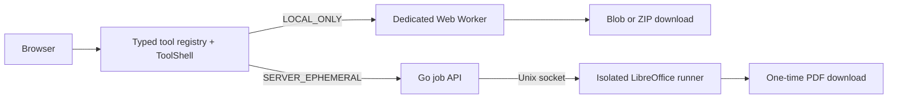

<p align="center">
  
</p>

<h1 align="center">AIO Converter</h1>

<p align="center">
  A modular file-conversion platform with local browser processing and short-lived server jobs for formats that require native applications.
</p>

<p align="center">
  <a href="#phase-1-features">Features</a> &middot;
  <a href="#quick-start">Quick start</a> &middot;
  <a href="#architecture">Architecture</a> &middot;
  <a href="#testing">Testing</a> &middot;
  <a href="#deployment">Deployment</a>
</p>

> **Status: Phase 1 / beta.** The application foundation and four Phase 1 tools are functional. The current UI/UX is a responsive, keyboard-accessible baseline while the final design is being prepared in Figma.
> Release status: public source available. Production release is blocked pending FFmpeg WASM provenance verification.

## Phase 1 features

| Tool         | Processing mode  | Key limits                              | Output                        |
| ------------ | ---------------- | --------------------------------------- | ----------------------------- |
| PNG to JPG   | Local in browser | 1-50 files, 50 MiB/file, 200 MiB total  | Individual JPG files or ZIP   |
| Merge PDF    | Local in browser | 2-20 files, 50 MiB/file, 250 MiB total  | One PDF in the selected order |
| Video to GIF | Local in browser | 1 file, 150 MiB, maximum 30-second clip | GIF                           |
| DOCX to PDF  | Ephemeral server | 1 file, 50 MiB                          | One-time PDF download         |

Every tool uses the same strongly typed registry for routes, metadata, validation, options, limits, privacy badges, and processor mappings. New tool variants do not require rebuilding the page from scratch.

## Privacy model

AIO Converter exposes two processing paths clearly to users:

- **`LOCAL_ONLY`** - PNG to JPG, Merge PDF, and Video to GIF run in browser Web Workers. Files are never sent to the API, and there is no hidden upload fallback.
- **`SERVER_EPHEMERAL`** - DOCX to PDF uses the Go API and an isolated LibreOffice runner. Inputs and outputs live in tmpfs, job metadata exists only in memory, output can be downloaded only once, and data is removed after completion, cancellation, failure, timeout, shutdown, or TTL expiry.

Server file responses use `Cache-Control: private, no-store`. Original filenames are not stored in job metadata, and user binaries are never written to a database, object storage, analytics, or application logs.

## Architecture



| Layer            | Technology                               | Responsibility                                                        |
| ---------------- | ---------------------------------------- | --------------------------------------------------------------------- |
| Web              | Astro 7, React 19, Tailwind CSS 4        | Static routes, generic tool shell, SEO, and accessibility             |
| Browser engine   | Web Worker, pdf-lib, ffmpeg.wasm, fflate | Local conversion, progress, cancellation, and output downloads        |
| API              | Go 1.24                                  | Streaming uploads, job lifecycle, SSE, one-time download, and cleanup |
| Office runner    | LibreOffice in a container               | DOCX conversion without network access or persistent storage          |
| Shared contracts | TypeScript workspace packages            | Registry, validation, processor contracts, and cross-app helpers      |

Main repository structure:

```text
apps/
  web/                 Astro frontend and Playwright E2E
  api/                 Go API, office runner, and integration tests
packages/
  tool-core/           Shared contracts and validation
  tool-registry/       Tool definitions and processor manifest
  browser-processors/  Image, PDF, FFmpeg, and ZIP processors
  server-contracts/    Job API client and SSE contract
  ui/                  Generic ToolShell and state machine
  shared/              Binary, MIME, and filename helpers
docs/                  Architecture, development, and deployment guides
```

See [docs/architecture.md](docs/architecture.md) for processing flows and security invariants.

## Quick start

### Prerequisites

- Node.js 22.14 or newer
- Corepack and pnpm 11
- Go 1.24 or newer
- Docker Compose for DOCX to PDF
- Playwright Chromium for E2E testing

### Frontend and local tools

```bash
corepack enable
pnpm install --frozen-lockfile
pnpm dev
```

Open <http://localhost:4321>. The three `LOCAL_ONLY` tools work without a backend. FFmpeg assets are generated automatically from the dependency during `dev` or `build` and do not need to be stored in Git.

### Full stack

Copy `.env.example` to `.env` only when you need to override the default configuration, then run:

```bash
pnpm dev:docker
```

This command starts the frontend and builds the API plus LibreOffice runner stack. The API is published only on `127.0.0.1:8080`; the office runner has no public port or network access.

See [docs/development.md](docs/development.md) for the complete development guide.

## Commands

| Command             | Purpose                                               |
| ------------------- | ----------------------------------------------------- |
| `pnpm dev`          | Start the Astro frontend                              |
| `pnpm dev:api`      | Start the backend through Docker Compose              |
| `pnpm dev:docker`   | Start the frontend and backend together               |
| `pnpm build`        | Build every workspace package and verify the Go build |
| `pnpm lint`         | Run ESLint and `go vet`                               |
| `pnpm typecheck`    | Check TypeScript and Astro                            |
| `pnpm test`         | Run JavaScript unit tests and Go tests                |
| `pnpm test:e2e`     | Run the Playwright E2E suite                          |
| `pnpm format:check` | Check source formatting                               |

## Configuration

Local configuration belongs in `.env`. A safe, commit-ready template is available at [.env.example](.env.example).

| Variable                  | Development default     | Purpose                                 |
| ------------------------- | ----------------------- | --------------------------------------- |
| `PUBLIC_APP_NAME`         | `AIO Converter`         | Application name in the UI and metadata |
| `PUBLIC_APP_URL`          | `http://localhost:4321` | Canonical frontend origin               |
| `PUBLIC_API_URL`          | `http://localhost:8080` | Job API base URL                        |
| `API_ALLOWED_ORIGINS`     | `http://localhost:4321` | Allowed frontend origin                 |
| `API_JOB_TTL`             | `15m`                   | Maximum lifetime of an ephemeral job    |
| `API_MAX_CONCURRENT_JOBS` | `1`                     | Active office jobs per instance         |

Do not commit `.env`, processor tokens, credentials, or user files. All backend variables and limits are documented in `.env.example`.

## Testing

Install the Playwright browser once on each development machine:

```bash
pnpm exec playwright install chromium
```

Run all quality gates before pushing or creating a release:

```bash
pnpm format:check
pnpm lint
pnpm typecheck
pnpm test
pnpm build
pnpm test:e2e
```

`pnpm test:e2e` requires Docker for the DOCX-to-PDF smoke test. Set `PLAYWRIGHT_SKIP_API_SERVER=1` for a browser-only audit, but that mode does not replace container-stack validation.

Phase 1 automated E2E coverage targets desktop and mobile Chromium. Safari and Firefox still require manual testing before claiming production-grade cross-browser support.

## Deployment

The frontend builds to static output in `apps/web/dist` and can be hosted on Cloudflare Pages. The API and LibreOffice runner must run on a separate container host that supports tmpfs, resource limits, Unix sockets, and an HTTPS reverse proxy.

Set `PUBLIC_APP_URL` and `PUBLIC_API_URL` before a production build. CSP and `connect-src` are generated at build time. See [docs/deployment.md](docs/deployment.md) for headers, origins, metrics, cleanup rules, and the production checklist.

## Adding a tool

1. Add the tool definition and limits to `packages/tool-registry`.
2. Reuse an existing processor or preset, or implement a new processor that follows the `tool-core` contract.
3. Register the processor mapping in the manifest.
4. Add help content, unit tests, and E2E coverage for critical flows.

Routes, metadata, privacy badges, initial validation, options, and related tools are derived from the registry. See [docs/architecture.md](docs/architecture.md) for details.

## Current limitations

- The UI is intentionally a basic visual foundation so it can be adapted once the Figma design is ready.
- Video to GIF uses WebAssembly and may require significant memory on low-end devices.
- DOCX fidelity depends on the fonts and LibreOffice capabilities in the runner image; output is not guaranteed to match Microsoft Word exactly.
- Full DOCX E2E testing requires a healthy Docker and LibreOffice container stack.
- Every tool is still marked beta, and the project is not positioned as a production-ready service.

## License and release gate

The AIO Converter source code is licensed under the **GPL-3.0-or-later**.

Third-party components remain under their own licenses. The project name, logo, and brand assets are not granted under the GPL.

Copyright (C) 2026 Idham Khalid.

See [THIRD_PARTY_NOTICES.md](THIRD_PARTY_NOTICES.md) for the dependency inventory and compliance notes.

## Documentation

- [Architecture and privacy model](docs/architecture.md)
- [Development setup and browser compatibility](docs/development.md)
- [Deployment and production checklist](docs/deployment.md)
- [Third-party notices](THIRD_PARTY_NOTICES.md)
